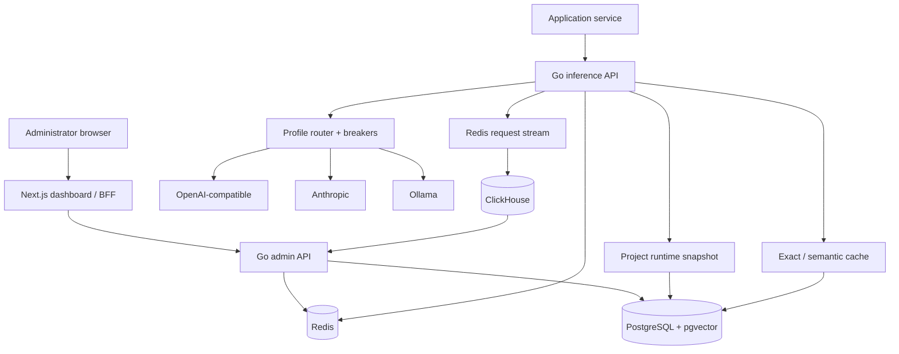

# Architecture

Conduit has two ways in: applications send inference requests to `/v1`, while administrators use the dashboard and `/control/v1` to manage projects. They share the same project configuration but use separate credentials.

## The project boundary

Provider connections, profiles, application keys, policies, members, cache rows, usage events, and audit events all carry a project ID. List and mutation queries enforce membership on the server; the dashboard is not trusted to filter another project’s data.

An application never selects a provider connection directly. It asks for a profile. A `generation` profile can serve Chat Completions and Responses; an `embedding` profile can serve Embeddings. The profile resolves to ordered or balanced provider/model targets.

Project changes increment a configuration version and publish a Redis invalidation. Gateway replicas discard the old in-memory runtime immediately; a five-second TTL is the fallback if a notification is missed.

## Why each dependency exists

- PostgreSQL is authoritative for identity and configuration. pgvector lives there so semantic cache rows and vectors share one project-aware transaction.
- Redis holds revocable sessions, distributed limits, monthly counters, configuration invalidations, and the durable request-event queue.
- ClickHouse stores request metadata for fast project usage queries. It is deliberately outside the inference transaction.

## Failure boundaries

- Redis unavailable: new inference and administrator sessions fail closed because identity, limits, and budgets cannot be trusted.
- PostgreSQL unavailable: admin changes stop; a loaded project runtime may serve only until its short TTL expires.
- ClickHouse unavailable: inference continues and stream entries remain pending in Redis.
- Cache query unavailable: the request skips caching and continues.
- Provider unavailable: retry classification, breakers, and profile fallback apply.
- Mid-stream provider failure: Conduit reports the stream error; it never joins text from two models into one answer.

Liveness checks only the process. Readiness checks the dependencies required to authenticate callers and enforce project rules.
