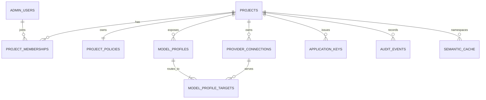

# Data model

The project is the isolation boundary.

- `admin_users` stores named local administrators with Argon2id password hashes. There is no public signup.
- `admin_invitations` stores one-use, expiring invitation hashes.
- `projects` owns a configuration version used for runtime invalidation.
- `project_memberships` assigns owner, admin, or viewer roles.
- `provider_connections` stores endpoint metadata and AES-256-GCM encrypted credentials. Associated data binds ciphertext to both project and provider IDs.
- `model_profiles` gives applications stable names and classifies each as `generation` or `embedding`.
- `model_profile_targets` stores upstream provider/model targets, order or weight, and administrator-maintained estimated prices.
- `application_keys` stores a public lookup identifier and SHA-256 secret hash. Plaintext is returned only at creation.
- `project_policies` stores request, token, user, budget, cache, attribution, and retention settings.
- `audit_events` stores sanitized before/after configuration metadata.
- `semantic_cache` is namespaced by project and policy version.

ClickHouse’s `conduit_requests` rows include operation, project, application key, environment, pseudonymous end user, profile, provider/model, attempts, latency, token usage, estimated cost, cache result, status, and error class.

Prompts and model outputs are intentionally absent. `X-Conduit-End-User` is removed before provider forwarding and stored only as an HMAC-SHA256 pseudonym scoped to the project, preventing cross-project correlation or recovery from analytics.
