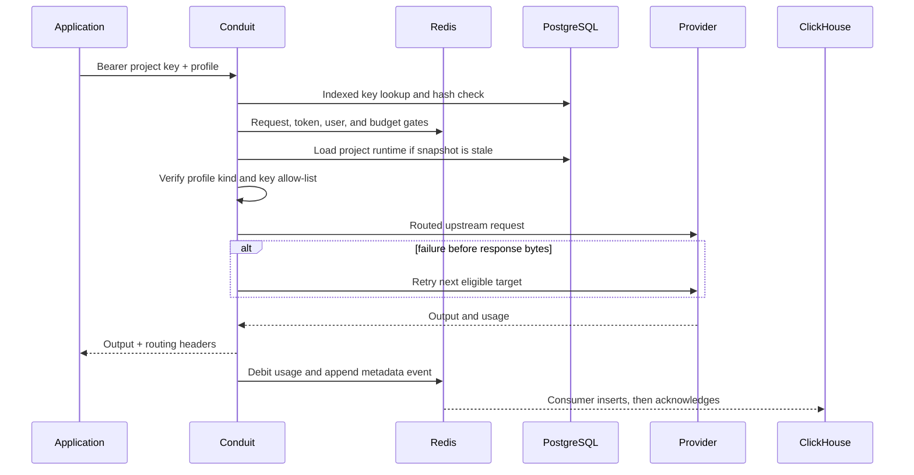

# Request lifecycle

The same application key, project policy, profile allow-list, quotas, budget, routing rules, and metadata recording apply to all inference APIs.

## Chat Completions

`POST /v1/chat/completions` accepts a generation profile. OpenAI-compatible payload fields are passed through when possible. Exact or semantic caching may answer before routing when project policy permits it. Streaming uses chat-completion SSE chunks and ends with `data: [DONE]`.

## Responses

`POST /v1/responses` also accepts a generation profile. Conduit translates the supported text request into its provider-neutral generation request, then returns a Responses-shaped object or typed Responses SSE events.

Supported in this iteration:

- string input or an array of message objects
- `instructions`, `temperature`, `top_p`, and `max_output_tokens`
- blocking and streaming text output

Not supported:

- `store: true`, `previous_response_id`, or provider conversations
- built-in or custom Responses tools
- background responses and provider-hosted response retrieval

Those features make state belong to one provider. Silent failover would either lose that state or send an identifier another provider cannot understand, so Conduit rejects them explicitly.

## Embeddings

`POST /v1/embeddings` accepts an embedding profile and forwards string, string-array, or token input to an OpenAI-compatible embeddings endpoint. It records input tokens and estimated input cost. Anthropic connections are rejected when an embedding profile is configured because Anthropic does not expose an embeddings API.

## Routing headers

Successful inference responses identify the decision without exposing credentials:

- `X-Conduit-Project` and `X-Conduit-Profile`
- `X-Conduit-Provider` and `X-Conduit-Model`
- `X-Conduit-Attempts`, duration, TTFB, and cache outcome where applicable
