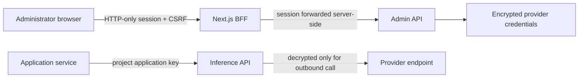

# Security model

## Administrator access

There is no public registration. The first platform owner is created with `conduit admin bootstrap`; other administrators activate one-use invitations. Passwords use Argon2id. Random session tokens are hashed in Redis, sent as HTTP-only cookies, and paired with CSRF tokens for mutations. Redis also handles login throttling and revocation.

## Application access

Application keys contain a public lookup ID and a high-entropy secret. PostgreSQL stores only the secret hash. The plaintext key appears once when it is created. Keys belong to a project and can be limited by profile, environment, expiry, request rate, and token rate.

## Provider credentials

Credentials are encrypted with AES-256-GCM under `CONDUIT_MASTER_KEY`. Authenticated encryption binds a ciphertext to its project and provider IDs, so copying it to a different row does not produce a usable secret. Management responses return only a non-secret fingerprint.

## Network boundary

Provider URLs are validated to prevent administrator-configured SSRF. Production expects HTTPS and rejects private or loopback targets unless they are explicitly allowed for local or Docker development. Provider tests use bounded requests and never return credential material.

## Logs and analytics

Secrets, password hashes, plaintext keys, prompts, responses, and raw end-user identifiers must not enter logs, audit JSON, or ClickHouse. Prometheus labels use bounded project/profile/provider values; application keys and end users are not labels.
